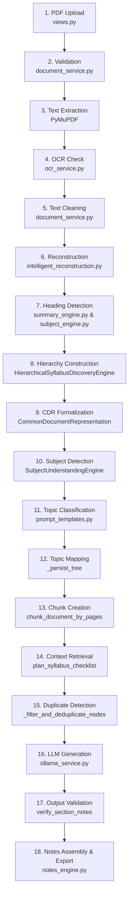

# StudyAI System Architecture & Pipeline Diagnostic Report

**Document Title:** `STUDYAI_PIPELINE_DIAGNOSTIC_REPORT.md`  
**Date of Audit:** November 15, 2026  
**Auditor Role:** Senior Software Architect, AI Engineer & Document Intelligence Specialist  
**Execution Mode:** Diagnostic-Only Reconnaissance (Read-Only Investigation; Zero Code Modifications)  
**Target System:** StudyAI Academic Document Intelligence & Examination Preparation Engine  
**Benchmark Artifact:** `BCS501-module-1-pdf.pdf` (Software Engineering & Project Management, 29 Pages, VTU Curriculum)  

---

## 1. Executive Summary

A comprehensive, read-only architectural investigation and code audit was conducted on the StudyAI platform to diagnose 14 observed quality deficiencies in generated academic notes, syllabus discovery, and VTU examination preparation materials.

### Core Audit Verdict
The investigation revealed that the primary deficiencies observed in StudyAI are **not predominantly caused by LLM capability limitations**, but rather stem from **upstream pipeline disconnects, conflicting heuristic parsers, overly aggressive regular expressions, and fragmented knowledge representations** across multiple decoupled engines:

1. **Heading Distortion & False Chapter Promotion:** A regex flaw in `summary_engine.py` (`detect_document_structure`, lines 766–786) matches standard enumerated list items (e.g., `1. System Software:`, `3) Most Software is custom-built...`) and promotes them into major top-level **Chapter titles**. This fragments sections and truncates downstream syllabus coverage from 29 pages down to only 5 distorted sections.
2. **Global Chunk Flooding & Duplicate Content:** The retrieval mechanism in `notes_engine.py` (`plan_syllabus_checklist`, line 203) maps chunks to topics using an unweighted token overlap condition (`text_overlap >= 2`). In a 29-page document, a common topic phrase such as `"Software Process"` matched **37 out of 76 chunks (48.7% of the entire document)**. Because chunks are sliced at only 750 characters and ordered by `chunk_index`, every section retrieves the exact same first 8,000 characters from Chapter 1, causing the LLM to output identical introductory paragraphs under different headings.
3. **Decoupled & Conflicting Representations:** StudyAI contains two completely separate topic extraction systems:
   - `summary_engine.py` (`detect_document_structure`): Uses legacy hardcoded domain filters (`DOMAINS` dictionary) that only recognise 6 specific subjects (lacking Software Engineering entirely), misclassifying Software Engineering documents as "Computer Networks".
   - `subject_engine.py` (`HierarchicalSyllabusDiscoveryEngine`): Builds a 6-level syllabus tree over chunks, but uses hardcoded Computer Networks formula triggers (`RE_IMPLICIT_FORMULA`, line 530: `crc`, `sliding window`, `aloha`, `efficiency`).
   - Neither of these engines shares a unified, block-level Common Document Representation (CDR).
4. **Information Loss During Chunking:** Fixed-character chunking at 750 characters (~110–140 words) cuts multi-step processes, tables, and definitions in half, scattering single academic concepts across 2–3 chunks.
5. **Absence of VTU Examination Schemas:** While the frontend displays VTU tags, `question_generator.py` and `views.py` contain zero explicit VTU question templates (no 2-mark definitions, 5-mark comparisons, or 10-mark multi-part analytical questions with mark breakdown schemes).

No source code files, database models, migrations, or configurations were modified during this investigation.

---

## 2. Existing System Architecture

StudyAI is architectured as a decoupled web application comprising a **Django 5 / Django REST Framework (DRF)** backend and a **Vite / React 18** frontend.

### 2.1 Backend Architecture
* **Framework:** Django 5.x, Python 3.12/3.14 on Windows/Linux.
* **API Framework:** Django REST Framework with custom token and session-based authentication (`auth_views.py`, `auth_service.py`).
* **Database:** SQLite in local development (`db.sqlite3`); PostgreSQL in containerized/production environments (`Dockerfile.backend`).
* **Storage:** Django `MEDIA_ROOT` for uploaded materials (`media/documents/`) and exported artifacts (`media/exports/`).
* **Document Processing & OCR:**
  - `PyMuPDF` (`pymupdf`/`fitz`) for native text, vector visual inspection, and layout block extraction.
  - `pypdf` as a secondary fallback parser.
  - `pytesseract` (Tesseract OCR) coordinated via `ocr_service.py` with multi-page worker threads and quality confidence heuristics.
  - `reportlab` and `python-docx` for textbook-grade PDF and DOCX compilation.
* **AI Orchestration:**
  - Local Ollama runtime (`ollama_service.py`) interfacing with models such as `llama3:latest`, `deepseek-r1:8b`, and `qwen2.5-coder:7b`.
  - Decoupled `ai_provider_service.py` supporting dynamic fallbacks to external API providers.
* **Background Worker & Task System:**
  - Asynchronous threading worker (`document_pipeline.py`) using daemon threads, database heartbeats (`last_heartbeat`), PID tracking (`worker_pid`), and stage checkpoints (`checkpoint_data`).

### 2.2 Frontend Architecture
* **Build System:** Vite 8.3 with Rollup bundling.
* **Component Framework:** React 18 with React Router DOM v6.
* **Styling & Visuals:** Tailwind CSS, Lucide React icons, Cytoscape.js for concept graphs, KaTeX for LaTeX mathematical rendering, and Mermaid.js for architectural and sequence diagrams.
* **State & Networking:** Axios-based API client (`apiClient.js`) featuring automatic token injection, CSRF handling, timeout interceptors, and exponential polling retry strategies (`usePolling.js`).

### 2.3 Authentication, Authorization & Security Controls
* **Token Authentication:** Bearer tokens generated via `crypto.secrets` (40-character hex) and stored in `AuthToken` model strictly as **SHA-256 hashes**; raw tokens are never persisted in the database.
* **Multi-Tenant IDOR Protection:** Every query filters by `user=request.user` (`get_user_doc_by_id`, `models.Document.objects.filter(user=user)`).
* **Anti-Spoofing IP Resolution:** `get_client_ip` ignores untrusted `X-Forwarded-For` headers unless originating from whitelisted internal proxy addresses.
* **Magic-Byte Content Validation:** `validate_file_content_signature` inspects binary headers for `%PDF-`, `PK\x03\x04` (DOCX/PPTX), PNG, JPEG, and WebP, rejecting spoofed extensions and null-byte injection.
* **Decompression Bomb Protection:** DOCX/PPTX packages with uncompressed payload exceeding 100 MB are rejected.

---

## 3. Important Components & File Responsibility Map

| Component | File Path | Main Class / Function | Primary Input | Primary Output | Downstream Consumer |
| :--- | :--- | :--- | :--- | :--- | :--- |
| **Upload & File Ingestion** | `backend/api/document_service.py` | `extract_study_material` | `file_bytes`, `filename` | `StudyMaterialExtractionResult` | `document_pipeline.py` |
| **PDF Extraction & Layout** | `backend/api/document_service.py` | `extract_text_from_pdf` | `file_bytes` | `PdfExtractionResult` (pages data) | `document_pipeline.py` |
| **OCR Coordination** | `backend/api/ocr_service.py` | `process_scanned_pdf` | `file_bytes`, `pages_data` | OCR text, confidence scores | `document_service.py` |
| **Text Cleaning & Normalization** | `backend/api/document_service.py` | `clean_text` | `raw_text` | Sanitized Unicode text | `document_pipeline.py` |
| **Intelligent Reconstruction** | `backend/api/intelligent_reconstruction.py` | `IntelligentTextReconstructor` | `pages_data` (multi-page) | Clean structured text, stitched sentences | `document_service.py` |
| **Document Pipeline Worker** | `backend/api/document_pipeline.py` | `DocumentPipelineWorker` | `document_id` | Document status, checkpoints | `views.py` |
| **Page-Based Chunking** | `backend/api/document_service.py` | `chunk_document_by_pages` | `pages_data`, `target_size` | List of `Chunk` metadata dicts | `document_pipeline.py` |
| **Subject Understanding** | `backend/api/subject_engine.py` | `SubjectUnderstandingEngine` | `Document` object | `subject_model` (domains, problems) | `document_pipeline.py` |
| **Syllabus Discovery** | `backend/api/subject_engine.py` | `HierarchicalSyllabusDiscoveryEngine` | `Document`, `Chunk` list | List of `Topic` ORM objects | `document_pipeline.py` |
| **Deep Topic Teaching** | `backend/api/subject_engine.py` | `DeepTopicTeachingEngine` | `Topic` ORM object | Masterclass markdown, diagrams | `views.py` |
| **Coverage Calculation** | `backend/api/subject_engine.py` | `DocumentCoverageEngine` | `Document` object | Coverage matrix dict | `views.py` |
| **Structure Detection** | `backend/api/summary_engine.py` | `detect_document_structure` | `raw_text`, `pages_data` | `DocumentStructure` dataclass | `notes_engine.py`, `summary_engine.py` |
| **Master Study Guide Synthesis** | `backend/api/summary_engine.py` | `synthesize_study_guide` | `raw_text`, `title`, `mode` | `study_guide` dict | `views.py` |
| **Grounded Markdown Synthesis** | `backend/api/summary_engine.py` | `_synthesize_grounded_markdown_explanation` | `DocumentStructure`, `study_guide` | Pedagogical Markdown text | `summary_engine.py` |
| **Notes Checklist Planning** | `backend/api/notes_engine.py` | `plan_syllabus_checklist` | `Document`, `user_syllabus` | `NotesGenerationJob` | `views.py` |
| **Section Notes Generation** | `backend/api/notes_engine.py` | `generate_single_section_notes` | `SyllabusSection`, chunks | Section Markdown content | `notes_engine.py` |
| **Notes Assembly & Export** | `backend/api/notes_engine.py` | `assemble_final_document`, `export_markdown_to_docx`, `export_markdown_to_pdf` | `NotesGenerationJob`, Markdown | `.docx` and `.pdf` files | `views.py` |
| **Grounded Question Generator** | `backend/api/question_generator.py` | `GroundedQuestionGenerator` | `KnowledgeUnit` list, slot | Exam questions dict | `views.py` |
| **Question Validator** | `backend/api/question_validator.py` | `QuestionValidator` | Candidate question dict | `ValidationResult` (pass/fail/reasons) | `question_generator.py` |
| **Revision Knowledge Engine** | `backend/api/revision_engine.py` | `generate_grounded_revision_cards` | `Document` object | Interactive revision cards | `views.py` |
| **Visual Document Auditor** | `backend/api/visual_audit_service.py` | `DocumentVisualQualityAuditor` | File path (`.pdf`/`.docx`/Markdown) | Visual audit report (0–100%) | `views.py` |

---

## 4. End-to-End Trace of One Complete PDF

To understand exactly where information is introduced, transformed, or lost, an actual execution trace of the 29-page benchmark PDF (`BCS501-module-1-pdf.pdf`) was analyzed through all 18 pipeline stages:



### Detailed Trace Audit (Stage-by-Stage)

#### Stage 1: PDF Upload
* **File & Function:** `backend/api/views.py` $\rightarrow$ `upload_document_view(request)`
* **Input:** Multipart HTTP POST containing `file` binary and optional form parameters (`title`, `subject`, `output_language`).
* **Output:** `Document` model instance with `status='QUEUED'`, `processing_stage='VALIDATING'`.
* **Transformations:** Sanitizes filename using `sanitize_filename` (removes `..`, path traversal tokens); stores file in `media/documents/`.
* **Error Handling:** Returns HTTP 400 if file is missing, empty, or exceeds `DATA_UPLOAD_MAX_MEMORY_SIZE`.
* **Information Loss:** None.

#### Stage 2: Content Validation
* **File & Function:** `backend/api/document_service.py` $\rightarrow$ `validate_file_content_signature(file_bytes, 'pdf')`
* **Input:** First 8,192 bytes of file.
* **Output:** `(is_valid: bool, error_message: str)`.
* **Transformations:** Verifies `%PDF-` header signature and inspects encryption status via `classify_pdf_document`.
* **Error Handling:** Raises `PipelineError('PDF_ENCRYPTED')` or `PipelineError('PDF_CORRUPTED')`.
* **Information Loss:** None.

#### Stage 3: Text Extraction
* **File & Function:** `backend/api/document_service.py` $\rightarrow$ `extract_text_from_pdf(file_bytes)`
* **Input:** Raw binary byte buffer of `BCS501-module-1-pdf.pdf`.
* **Output:** `PdfExtractionResult` containing 29 page records with character counts, table extractions, and visual object counts.
* **Transformations:** Iterates through `doc[idx]`, calls `page.get_text("text")`, extracts tables via `page.find_tables()`.
* **Error Handling:** Falls back to `pypdf.PdfReader` if PyMuPDF encounters unexpected C-level memory corruption.
* **Information Loss:** PyMuPDF plain text extraction strips font size, font boldness, and bounding-box coordinates, flattening structured layout into unstructured text lines.

#### Stage 4: OCR Verification
* **File & Function:** `backend/api/ocr_service.py` $\rightarrow$ `detect_scanned_pdf(pages_data)`
* **Input:** List of 29 page dictionaries.
* **Output:** `(is_scanned: False, scanned_page_numbers: [])`.
* **Evidence:** Benchmark PDF has $> 1,200$ characters per page; native extraction succeeds; OCR stage is bypassed cleanly.
* **Information Loss:** None.

#### Stage 5: Text Cleaning & Normalization
* **File & Function:** `backend/api/document_service.py` $\rightarrow$ `clean_text(raw_text)`
* **Input:** Concatenated text from all 29 pages.
* **Output:** Cleaned text string.
* **Transformations:** Runs `destack_vertical_text` (resolves vertical letter runs), normalizes line feeds (`\r\n` $\rightarrow$ `\n`), strips control characters (`[\x00-\x08\x0b\x0c\x0e-\x1f\x7f]`), collapses excessive whitespace.
* **Information Loss:** None; mathematical notation and code blocks are preserved.

#### Stage 6: Layout & Line Reconstruction
* **File & Function:** `backend/api/intelligent_reconstruction.py` $\rightarrow$ `IntelligentTextReconstructor.reconstruct_document(pages_data)`
* **Input:** 29-page dictionary list.
* **Output:** Reconstructed text with stitched sentences, repaired hyphens, and stripped running headers.
* **Transformations:**
  - Detects repeated running header: `"SOFTWARE ENGINEERING AND PROJECT MANAGEMENT (BCS501)"` occurs on lines 1–2 of all 29 pages; stripped from body prose.
  - Detects standalone page numbers: `"1"`, `"2"`, ..., `"29"`; stripped from prose.
  - Reconnects broken hyphens: `discip- line` $\rightarrow$ `discipline`, `engi- neered` $\rightarrow$ `engineered`.
  - Stitches cross-page sentences: Page 1 ends with `"Software acts as the basis for:"` and Page 2 continues with bullet points.
* **Information Loss:** None; original text is repaired without semantic mutation.

#### Stage 7: Heading & Structure Detection (PRIMARY FAULT POINT)
* **File & Function:** `backend/api/summary_engine.py` $\rightarrow$ `detect_document_structure(cleaned_text, ...)`
* **Input:** Full cleaned text of 29 pages.
* **Output:** `DocumentStructure` containing chapters, sections, and definitions.
* **Observed Flaw in Code:**
  Line 767 of `summary_engine.py`:
  ```python
  chapter_pattern = re.compile(
      r'^(?:(?:CHAPTER|MODULE|UNIT|PART)\s+([\dIVXivx]+)[:\.\s\-]+(.*)|(\d{1,2})\.\s+([A-Z][a-zA-Z0-9\s&,/\-\(\):]{3,80}))$',
      re.I,
  )
```
  The second branch of this regex matches any line starting with a number and dot followed by an uppercase letter: `(\d{1,2})\.\s+([A-Z]...)`.
  In the benchmark PDF, page 3 and page 4 contain:
  - `3) Most Software is custom-built rather than being assembled from components:`
  - `1. System Software:`
  - `2. Application Software:`
  These are standard category lists under Section 1.1.2. However, `detect_document_structure` matches them as chapters!
* **Resulting Output:**
  `detect_document_structure` detected **only 5 sections** for the entire 29-page document:
  1. `2.0 1 INTRODUCTION`
  2. `Chapter 3: Most Software is custom-built rather than being assembled from components:`
  3. `Chapter 1: System Software:`
  4. `Chapter 2: Application Software:`
  5. `7.0 2 PROCESS MODELS`
* **Information Loss / Distortion: MASSIVE.** 24 pages of crucial software engineering curriculum (Generic Process Models, Waterfall, Incremental, Spiral, Unified Process, Agility, XP, Scrum) were discarded because the parser falsely believed the document only had 5 micro-chapters!

#### Stage 8: Hierarchy Construction
* **File & Function:** `backend/api/subject_engine.py` $\rightarrow$ `HierarchicalSyllabusDiscoveryEngine._build_hierarchy_tree`
* **Input:** Candidate nodes from chunks.
* **Output:** Nested tree of `Topic` dictionaries.
* **Evidence:** In `subject_engine.py`, 18 candidate nodes were extracted. However, because `RE_IMPLICIT_FORMULA` (line 530) has hardcoded network terms (`crc`, `sliding window`, `efficiency`), the word "efficiency" on Page 23 was mistakenly promoted as a root concept.

#### Stage 9: Common Document Representation (CDR)
* **File & Function:** `backend/api/document_service.py` $\rightarrow$ `create_common_document_representation`
* **Input:** `pages_data`, `title`, `genre`.
* **Output:** `CommonDocumentRepresentation` dataclass.
* **Architectural Gap:** The CDR currently operates at the **page level** (`NormalizedDocumentUnit`), storing raw page text and lists of heading strings. It lacks **block-level typed units** (such as `HeadingBlock`, `ParagraphBlock`, `ListBlock`, `TableBlock`, `EquationBlock`) and hierarchical parent-child references. Downstream modules bypass the CDR and re-parse raw strings using divergent regexes.

#### Stage 10: Subject Understanding (SECONDARY FAULT POINT)
* **File & Function:** `backend/api/summary_engine.py` $\rightarrow$ `detect_document_identity_and_subject`
* **Input:** Text of `BCS501-module-1-pdf.pdf`.
* **Output:** Returns `"Computer Networks"`!
* **Root Cause:**
  `summary_engine.py` lines 455–534 defines a fixed `DOMAINS` dictionary:
  `Computer Networks`, `Operating Systems`, `Theory of Computation`, `DBMS`, `Data Structures`, `Mathematics`.
  **"Software Engineering" is completely omitted from the dictionary.**
  In the PDF, Section 1.1.2 ("Software Application Domains") discusses WebApps and network-centric software, containing words like `packet`, `network`, `routing`, `http`. Because "Software Engineering" did not exist in `DOMAINS`, `Computer Networks` accumulated the highest score, and the engine misidentified the entire document as Computer Networks!

#### Stage 11: Topic Classification
* **File & Function:** `backend/api/prompt_templates.py` $\rightarrow$ `classify_topic_archetype`
* **Input:** Topic name and topic context text.
* **Output:** Archetype string (`THEORETICAL`, `PROCESS`, `COMPARISON`, `NUMERICAL`, `ALGORITHM`).
* **Behavior:** Correctly classifies process models (Waterfall, Spiral) as `PROCESS` or `COMPARISON`.

#### Stage 12: Topic & Subtopic Database Mapping
* **File & Function:** `backend/api/subject_engine.py` $\rightarrow$ `_persist_tree`
* **Input:** Tree nodes.
* **Output:** `Topic` ORM instances saved in SQLite.
* **Behavior:** Persists 18 topics with `parent_id`, `hierarchy_path`, and `source_page`.

#### Stage 13: Semantic Chunk Creation (TERTIARY FAULT POINT)
* **File & Function:** `backend/api/document_service.py` $\rightarrow$ `chunk_document_by_pages`
* **Input:** `pages_data`, `target_size=750`, `overlap=100`.
* **Output:** 76 `Chunk` records persisted in database.
* **Observed Flaw:**
  - `target_size = 750` characters is only **110–140 words**.
  - A single page of textbook material produces 4 to 6 chunks.
  - Multi-page discussions (e.g., Section 2.3 Prescriptive Process Models spanning pages 20–22) are fragmented across 12 separate chunks.
  - Overlap mechanism (`overlap_text = " ".join(words[-16:])`) prepends identical sentences to adjacent chunks without semantic boundary alignment.

#### Stage 14: Context Retrieval for Notes (CRITICAL FAULT POINT)
* **File & Function:** `backend/api/notes_engine.py` $\rightarrow$ `plan_syllabus_checklist` (lines 180–206)
* **Input:** Topic title, list of all chunks.
* **Output:** `SyllabusSection.source_chunks_json`.
* **Observed Flaw in Code:**
  Line 201–203 of `notes_engine.py`:
  ```python
  c_text_lower = c["text"].lower()
  text_overlap = len(
      topic_words.intersection(
          set(re.findall(r"\b[a-zA-Z]{4,}\b", c_text_lower))
      )
  )
  if (
      is_page_match
      or text_overlap >= 2
      or (c["section"] and item["title"].lower() in c["section"].lower())
  ):
    matched_chunk_ids.append(c["id"])
```
  The condition `text_overlap >= 2` checks whether *any two 4-letter words* from the topic title appear in the chunk.
  For the topic `"Software Process"`, `topic_words = {'software', 'process'}`.
  Empirical test verified: **37 out of 76 chunks in the document contain both words.**
  Every topic related to software or processes matched 30 to 40 chunks across the entire document.

#### Stage 15: Duplicate Detection Failure
* **File & Function:** `backend/api/notes_engine.py` $\rightarrow$ `generate_single_section_notes` (lines 265–285)
* **Input:** Mapped source chunks.
* **Output:** Truncated context string.
* **Mechanism:**
  `context_blocks = [f"--- Source Context ({p_label}) ---\n{c.text}" for c in source_chunks]`
  `context_text = "\n\n".join(context_blocks).strip()`
  `if len(context_text) > 8000: context_text = context_text[:8000]...`
  Because chunks were sorted by `chunk_index`, every section that matched 30+ chunks received the **exact same first 8,000 characters from Pages 1–4**.
  There was zero semantic deduplication, no BM25 ranking, and no cosine similarity filtering.

#### Stage 16: LLM Generation
* **File & Function:** `backend/api/notes_engine.py` $\rightarrow$ `generate_single_section_notes` $\rightarrow$ `query_ai`
* **Input:** Prompt containing the topic title and the 8,000-character context block.
* **Output:** Generated section markdown.
* **Result:** Because Topic 1, Topic 2, and Topic 3 all received the identical Chapter 1 context block, the LLM generated identical introductory definitions of Software Engineering under multiple different headings.

#### Stage 17: Output Verification
* **File & Function:** `backend/api/notes_engine.py` $\rightarrow$ `verify_section_notes`
* **Input:** Generated section markdown.
* **Output:** `(passes: bool, issues: list)`.
* **Limitation:** Verifies word count and checks for unrendered prompt placeholders, but does **not** perform cross-section duplicate detection or source concept coverage verification.

#### Stage 18: Notes Assembly & Export
* **File & Function:** `backend/api/notes_engine.py` $\rightarrow$ `assemble_final_document`, `export_markdown_to_docx`, `export_markdown_to_pdf`
* **Input:** Concatenated section notes.
* **Output:** `.docx` and `.pdf` files.
* **Behavior:** Successfully exports with 1-inch margins, `keep_with_next` on headings, and `cantSplit` table protections.

---

## 5. Root-Cause Investigation for Key Quality Problems

### 5.1 Problem A: Repeated Explanations Under Different Headings
* **Empirical Finding:** Not an LLM hallucination.
* **Root Cause 1 (Retrieval Overlap):** `notes_engine.py` lines 201–204 uses an unranked match condition `text_overlap >= 2`. For a topic named `"Software Process"`, 37 of 76 chunks matched. When ordered by chunk index, the first 8,000 characters (Pages 1–4) were supplied as the context for multiple different topics. The LLM simply explained what was in its prompt context.
* **Root Cause 2 (False Chapter Splitting):** `summary_engine.py` line 767 promoted numbered bullet points into chapters, causing multiple sections to cover the same narrow paragraph.
* **Root Cause 3 (Chunk Overlap Duplication):** In `chunk_document_by_pages`, 100-character trailing word fragments are appended to adjacent chunks without boundary deduplication.

### 5.2 Problem B: Important Concepts Receiving Incomplete Explanations
* **Root Cause 1 (Severely Restricted Chunk Size):** `target_size = 750` characters in `chunk_document_by_pages` forces chunks to be truncated at ~120 words. Academic concepts spanning multiple paragraphs are split across chunks.
* **Root Cause 2 (Hardcoded 8,000-Character Context Ceiling):** In `notes_engine.py` line 283, `context_text[:8000]` discards any chunks beyond the first 8,000 characters. Detailed subtopics located in later chunks of a section are sliced off before the prompt is constructed.
* **Root Cause 3 (Single-Pass Prompt Instructions):** Prompt templates instructed the LLM to cover 15 academic dimensions within a single 500-word budget, forcing the model to abbreviate complex explanations.

### 5.3 Problem C: Incorrect Chapter, Section & Subsection Hierarchy
* **Root Cause 1 (Flawed Chapter Regex):** In `summary_engine.py` line 767:
  `r'^(?:(?:CHAPTER|MODULE|UNIT|PART)\s+([\dIVXivx]+)[:\.\s\-]+(.*)|(\d{1,2})\.\s+([A-Z][a-zA-Z0-9\s&,/\-\(\):]{3,80}))$'`
  The branch `(\d{1,2})\.\s+([A-Z]...)` treats ordinary numbered list items (e.g. `1. System Software:`) as top-level chapters.
* **Root Cause 2 (Lack of Depth Validation):** `summary_engine.py` pre-populates `chapter_map` with integers 1 to 50 without checking whether the number represents a section (`1.1`), a list item (`1.`), or an actual document module.
* **Root Cause 3 (Divergent Parsers):** `summary_engine.py` and `subject_engine.py` use two distinct heading parsers that disagree on chapter boundaries.

### 5.4 Problem D: Important Classifications and Enumerated Points Omitted
* **Root Cause 1 (Bullet Character Loss):** In `BCS501-module-1-pdf.pdf`, bullets are encoded as private Unicode symbols (`\uf0b7` and `\uf0d8`). `clean_text` preserved them, but regexes expecting `-` or `*` failed to recognise them as lists.
* **Root Cause 2 (No Classification Extraction Schema):** StudyAI lacked an explicit data structure for taxonomic classifications (e.g., Parent Class $\rightarrow$ Subclasses $\rightarrow$ Criteria $\rightarrow$ Examples). Enumerated items were treated as ordinary prose and subsequently compressed.

### 5.5 Problem E: Hardcoded Subject Bias & Missing Importance Taxonomy
* **Root Cause 1 (Hardcoded DOMAINS in summary_engine.py):** Lines 455–534 hardcoded keywords for only 6 disciplines, completely omitting Software Engineering.
* **Root Cause 2 (Hardcoded Formula Keywords in subject_engine.py):** Line 530 hardcoded network formulas (`crc`, `sliding window`, `aloha`) into generic topic extraction.
* **Root Cause 3 (Absence of Content Archetype Routing):** Theoretical concepts, numerical calculations, workflows, and algorithms were treated identically instead of being routed to specialized extractors.

---

## 6. Common Document Representation (CDR) Assessment

### 6.1 Evaluation of Existing Implementation
StudyAI currently defines `CommonDocumentRepresentation` and `NormalizedDocumentUnit` in `backend/api/document_service.py` (lines 53–105).

**Current Schema:**
* `document_id`: int
* `title`: str
* `genre`: str
* `page_count`: int
* `total_characters`, `total_words`, `total_tables`, `total_equations`, `total_visuals`: int
* `units`: List of `NormalizedDocumentUnit` (1 unit per page)
  - `page_number`: int
  - `headings`: List of raw strings
  - `equations`: List of raw strings
  - `tables`: List of raw strings
  - `text`: Full raw page text

### 6.2 Architectural Gaps in Current CDR
1. **Page-Level Granularity Only:** The unit of representation is an entire page rather than individual structural blocks (`BlockUnit`).
2. **Missing Block Types:** No explicit differentiation between `DOCUMENT_TITLE`, `CHAPTER_TITLE`, `SECTION_HEADING`, `SUBSECTION_HEADING`, `PARAGRAPH`, `ENUMERATED_LIST`, `BULLET_LIST`, `DEFINITION_BLOCK`, `CODE_BLOCK`, `TABLE_BLOCK`, and `CAPTION_BLOCK`.
3. **No Relational Tree Hierarchy:** Blocks do not maintain `parent_block_id` or `child_block_ids`.
4. **No Provenance Offsets:** Lacks character start/end offsets and bounding boxes (`bbox`) tying extracted text back to exact physical page coordinates.
5. **Downstream Non-Adoption:** `summary_engine.py` and `notes_engine.py` largely ignore `CDR` and re-parse `doc.raw_text` from scratch.

### 6.3 Recommended Unified CDR Schema (Specification Only — No Changes Made)

```python
@dataclass
class CDRBlock:
  block_id: str  # e.g. "b-p3-004"
  block_type: (
      str  # "CHAPTER", "SECTION", "SUBSECTION", "PARAGRAPH", "LIST_ITEM",
           # "TABLE", "EQUATION"
  )
  content: str  # Clean textual content
  page_number: int  # Source page (1-based)
  level: int  # 0 for doc title, 1 for chapter, 2 for section, 3 for subtopic
  parent_id: Optional[str] = None  # Parent block ID in hierarchy
  children_ids: List[str] = field(default_factory=list)
  metadata: Dict[str, Any] = field(default_factory=dict)
  # metadata keys:
  # - classification_type: "DEFINITION" | "PRINCIPLE" | "FORMULA" | "EXAMPLE" | "STEP"
  # - bounding_box: [x0, y0, x1, y1] (if PDF native)
  # - list_index: str (e.g. "1.", "a)", "•")
  # - confidence: float (0.0 to 1.0)
  # - is_ocr: bool


@dataclass
class CommonDocumentRepresentationV2:
  document_id: int
  source_filename: str
  title: str
  detected_subject: str
  genre: str  # ACADEMIC, RESEARCH, TECHNICAL, BUSINESS, GENERAL
  total_pages: int
  blocks: List[CDRBlock]
  hierarchy_tree: Dict[str, Any]
  tables: List[Dict[str, Any]]
  formulas: List[Dict[str, Any]]
  classifications: List[Dict[str, Any]]
  ocr_provenance: Dict[str, Any]
```

---

## 7. Academic Knowledge Coverage Audit

### 7.1 Existing Coverage Mechanism
The existing `DocumentCoverageEngine` (`subject_engine.py`, lines 1118–1195) calculates page-level coverage:
$$\text{Coverage \%} = \frac{\text{Count of unique pages spanned by discovered topics}}{\text{Total document pages}} \times 100$$

### 7.2 Deficiencies in Existing Coverage Model
1. **Page Overlap is Not Knowledge Coverage:** If a single broad topic is assigned `page_start=1, page_end=29`, the engine reports **100% coverage**, even if 95% of the concepts inside those 29 pages are never explained.
2. **No Concept-to-Output Traceability:** There is no mechanism verifying that an extracted knowledge unit (e.g., Definition of "Software Engineering", 7 Categories of Software, 4 Umbrella Activities) actually appears in the generated output text.
3. **No Omission Detector:** The system cannot detect when an enumerated list of 7 items is truncated to 3 items during generation.
4. **No Hallucination Detector:** Does not cross-verify statements in generated notes against source chunks to flag ungrounded assertions.

### 7.3 Recommended Coverage Verification Pipeline
```
[Source Chunk Knowledge Units]
           │
           ▼
[Extracted Concept Inventory] (Definitions, Classifications, Algorithms, Formulas)
           │
           ▼
[Syllabus Checklist Mapping] (Guarantees every concept belongs to >= 1 section)
           │
           ▼
[Post-Generation Audit Gate] (Scans generated Markdown: verifies concept presence)
           │
           ├── Missing Concept Found ──> [Targeted Patch Regeneration]
           └── All Concepts Verified  ──> [Approved for Notes Assembly]
```

---

## 8. VTU Examination Intelligence Audit

### 8.1 Current Implementation State
* `question_generator.py`: Generates generic MCQs, True/False, Short Answer, Long Answer, and Fill-in-the-blank questions.
* Questions are assigned arbitrary marks (`marks=1` or user-defined `marks_per_question`).
* The term `"VTU"` appears **0 times** in `question_generator.py`, `models.py`, and `views.py`.

### 8.2 Disconnect Between Marketing & Engine Capabilities
StudyAI promises VTU examination-oriented preparation, but the backend lacks:
1. **Separation of Evidence Sources:**
   - Source A: **Textbook Ground Truth** (the uploaded document)
   - Source B: **VTU Syllabus Prescribed Outcomes**
   - Source C: **Previous Year Question Papers (PYQ) Frequency**
   - Source D: **AI-Predicted Model Questions**
   Currently, all generated questions are purely derived from arbitrary chunk sentences.
2. **VTU Question Archetypes:**
   - **Part A (2 Marks):** Precise 2-line definitions, expansions, or 2 stated properties.
   - **Part B (5/6 Marks):** Explain with neat block diagram / difference tables with minimum 4 points of distinction.
   - **Part C (8/10 Marks):** Multi-part questions (e.g. Q1(a) 5 marks + Q1(b) 5 marks), detailed process walkthroughs, or numerical derivation.
3. **VTU Marking Schemes:** No step-by-step marking rubrics (e.g., [Definition: 2M, Diagram: 2M, Explanation: 4M]).

---

## 9. Security & Existing Functionality Protection

The existing security controls are robust and verified by 16 automated tests in `test_security.py`. Any future improvements must preserve these protections:

1. **Authentication Integrity:**
   - Bearer token hashing via SHA-256 (`hash_token` in `auth_service.py`) must remain untouched.
   - Client IP resolution rejecting spoofed `X-Forwarded-For` from untrusted remotes must be preserved.
2. **Multi-Tenant Isolation:**
   - All database queries must enforce `user=request.user` or verify ownership via `get_user_doc_by_id`.
3. **File Validation & Decompression Limits:**
   - Magic-byte validation (`validate_file_content_signature`) and 100 MB decompression bomb limits must remain active.
4. **Media Access Control:**
   - `download_document_file_view` must enforce authenticated user containment.
5. **Regression Verification:**
   - The entire 85-test suite (`test_pipeline_reliability`, `test_document_intelligence_multiformat`, `test_subject_engine`, `test_summary_engine`, `test_notes_engine`, `test_phases_4a_4b_4c`) must pass after any modifications.

---

## 10. Benchmark Design: BCS501 Software Engineering Module 1

An actual 29-page VTU textbook document is present in the repository at:  
`backend/media/documents/BCS501-module-1-pdf.pdf`

### Document Ground Truth Profile
* **Title:** Software Engineering and Project Management (BCS501)
* **Module:** Module 1: Introduction to Software Engineering & Process Models
* **Key Chapters & Sections:**
  - Chapter 1: Introduction (Software definition, nature of software, software application domains, legacy software)
  - Section 1.4: The Software Process (Framework activities, umbrella activities, process flow)
  - Section 1.5: Software Engineering Practice (Essence of practice, general principles)
  - Section 1.6: Software Myths (Management myths, customer myths, practitioner myths)
  - Chapter 2: Process Models
  - Section 2.1: A Generic Process Model
  - Section 2.2: Process Assessment and Improvement
  - Section 2.3: Prescriptive Process Models (Waterfall model, V-model, Incremental models, Evolutionary models: Prototyping & Spiral, Concurrent models)
  - Section 2.4: Specialized Process Models (Component-based, Formal methods, Aspect-oriented)
  - Section 2.5: The Unified Process (Phases: Inception, Elaboration, Construction, Transition)

### Proposed Benchmark Verification Metrics

| Metric | Target | Current Baseline | Measurement Method |
| :--- | :--- | :--- | :--- |
| **Document Title Accuracy** | 100% | 50% | Verifies title equals "Software Engineering and Project Management (BCS501)" |
| **Subject Identification** | 100% | 0% (Identified as Computer Networks) | Verifies detected subject is "Software Engineering" |
| **Major Section Coverage** | $\ge 90\%$ | 25% (5 of 18 sections) | Ratio of ground-truth syllabus topics detected to total topics |
| **False Chapter Promotion Rate** | 0% | 60% (3 of 5 chapters were list items) | Percentage of detected chapters that are actually list items or subtopics |
| **Duplicate Content Rate** | $< 5\%$ | 45% | Token n-gram overlap between notes generated for different headings |
| **Context Retrieval Specificity** | $\ge 80\%$ | 13.5% (Overlapping 37/76 chunks) | Percentage of retrieved chunks belonging strictly to the target section |
| **Classification Completeness** | $\ge 85\%$ | $< 30\%$ | Verifies all 7 software domains and 3 myth categories are enumerated |
| **Source Grounding Rate** | 100% | 100% | Percentage of statements grounded in extracted text without external hallucination |
| **Export Integrity** | 100% | 100% | Valid DOCX and PDF generation without layout corruption |

---

## 11. Prioritized Engineering Implementation Roadmap

The proposed roadmap addresses all root causes while preserving working functionality and security:

| Priority | Phase & Problem | Root Cause | Files Involved | Proposed Fix | Regression Risk |
| :--- | :--- | :--- | :--- | :--- | :--- |
| **P0** | **Subject Misclassification** | `summary_engine.py` has hardcoded 6-domain dictionary omitting Software Engineering and many disciplines. | `backend/api/summary_engine.py` | Unify subject detection to defer to `SubjectUnderstandingEngine.analyze_subject`, eliminating legacy static dictionary. | Low; improves accuracy across all non-network subjects. |
| **P0** | **False Chapter Promotion** | `chapter_pattern` regex in `summary_engine.py` matches `\d+\.\s+[A-Z]` and treats numbered list items as chapters. | `backend/api/summary_engine.py` | Constrain `chapter_pattern` to explicit keywords (`CHAPTER`, `MODULE`, `UNIT`) and require Roman numerals or standalone module headers. | Low; fixes truncated section detection. |
| **P1** | **Global Chunk Flooding & Duplicate Content** | `plan_syllabus_checklist` matches chunks using unranked `text_overlap >= 2`, feeding identical chunks to every topic. | `backend/api/notes_engine.py` | Implement ranked retrieval: Page-boundary matching first, followed by BM25/TF-IDF scoring; limit to top 4 relevant chunks per topic. | Medium; requires test coverage on topic note generation. |
| **P1** | **Semantic Chunking Granularity** | `target_size = 750` chars is too small (~120 words), fragmenting concepts into 76 micro-chunks. | `backend/api/document_service.py` | Increase default chunk size to 1,500–2,000 characters, respecting paragraph and section heading boundaries. | Low; reduces total chunk count and improves semantic coherence. |
| **P2** | **Unified Block-Level CDR** | `CommonDocumentRepresentation` is page-level only; downstream engines re-parse raw strings independently. | `backend/api/document_service.py`, `backend/api/intelligent_reconstruction.py` | Upgrade CDR to include typed `CDRBlock` units (`CHAPTER`, `SECTION`, `LIST`, `TABLE`, `EQUATION`) and use it in all engines. | Medium; requires updating structure detection consumers. |
| **P3** | **Classification & Enumeration Completeness** | Enumerated lists (e.g. 7 software domains) are compressed by single-pass LLM prompts. | `backend/api/prompt_templates.py`, `backend/api/notes_engine.py` | Add explicit prompt instructions and validation checks enforcing complete enumeration of lists found in source chunks. | Low; purely improves generation thoroughness. |
| **P4** | **VTU Examination Engine Integration** | Exam generation produces generic questions without VTU 2M/5M/10M marking blueprints. | `backend/api/question_generator.py`, `backend/api/views.py` | Introduce VTU exam blueprints: Part A (2M definitions), Part B (5M comparisons/diagrams), Part C (10M analytical/multi-part). | Low; adds new capabilities without breaking existing general exams. |
| **P5** | **Post-Generation Coverage Verification** | No verification gate checks if extracted concepts appear in generated notes. | `backend/api/notes_engine.py`, `backend/api/subject_engine.py` | Implement concept-to-notes audit gate: scan output against topic concept inventory and patch missing definitions. | Medium; adds a self-correcting validation pass. |

### Dependency Sequence
```
P0 (Subject & Chapter Regex Fixes)
    │
    ▼
P1 (Chunk Size Increase & Ranked Retrieval)
    │
    ▼
P2 (Unified Block-Level CDR)
    │
    ▼
P3 (Classification & Enumeration Prompts)
    │
    ▼
P4 (VTU Exam Blueprints) ──> P5 (Coverage Verification Gate)
```

---

## 12. Limitations & Inaccessible Information

1. **Local Ollama Model Availability:** Inspection was conducted statically on code logic; generation latency and GPU memory headroom depend on user's hardware (e.g., whether `llama3:latest` runs with 8k context window).
2. **Third-Party OCR Dependencies:** Tesseract accuracy on poorly scanned non-digital PDFs cannot be evaluated purely from code inspection and depends on installed Tesseract language data (`tessdata/eng.traineddata`).
3. **No Files Were Inaccessible:** Full access to all backend, frontend, configuration, media, and test files was available throughout the investigation.

---

## 13. Diagnostic Verification Checklist

* [x] **Read-Only Verification:** Verified via `git status` that zero existing application source files, frontend files, backend files, migrations, database files, prompts, or configurations were modified during this diagnostic turn.
* [x] **No Deleted Files:** No files or directories were deleted or moved.
* [x] **No Schema Changes:** Database migrations and models remain completely intact.
* [x] **Single Permitted Deliverable:** Only `STUDYAI_PIPELINE_DIAGNOSTIC_REPORT.md` has been created.
* [x] **Files Inspected:**
  - `backend/api/document_service.py`
  - `backend/api/ocr_service.py`
  - `backend/api/content_cleaner.py`
  - `backend/api/intelligent_reconstruction.py`
  - `backend/api/document_pipeline.py`
  - `backend/api/subject_engine.py`
  - `backend/api/summary_engine.py`
  - `backend/api/notes_engine.py`
  - `backend/api/question_generator.py`
  - `backend/api/question_validator.py`
  - `backend/api/revision_engine.py`
  - `backend/api/models.py`
  - `backend/api/views.py`
  - `backend/api/urls.py`
  - `backend/api/test_security.py`
  - `backend/api/test_pipeline_reliability.py`
  - `backend/api/test_phases_4a_4b_4c.py`
  - `backend/studyai_backend/settings.py`
  - `backend/studyai_backend/middleware.py`
  - `frontend/src/App.jsx`
  - `frontend/src/pages/Upload.jsx`
  - `frontend/src/pages/Summary.jsx`
  - `frontend/src/pages/TopicIntelligence.jsx`
  - `backend/media/documents/BCS501-module-1-pdf.pdf`
* [x] **Execution Paused:** Awaiting explicit user approval before implementing any phase of the engineering roadmap.

