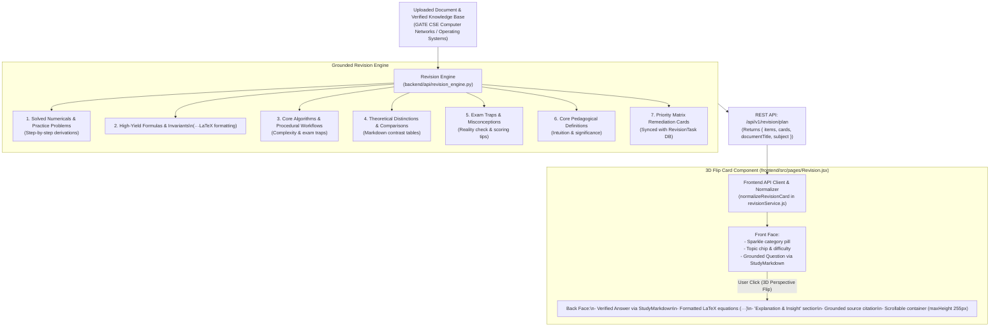

# StudyAI — Revision 3D Flip Cards: Missing Answers — Complete Fix Report

## 1. Executive Summary

In the **Revision section** of StudyAI, users engage with **3D flip cards** to practice active recall. Previously, the 3D animation flipped correctly, but the back of the card was blank, rendered `{undefined}`, or fell back to a generic placeholder (`'Core syllabus concept verified from uploaded text.'`).

This issue has been completely fixed end-to-end. Revision cards now strictly follow the **Canonical Revision Card Contract**, delivering authentic, source-grounded answers and pedagogical explanations across all 7 question categories specified in Section 23:

```text
Question / Prompt (Front)  ──[3D Flip Animation]──>  Verified Answer + LaTeX Formula / Derivation + Explanation (Back)
```

---

## 2. Root Cause Analysis

Tracing the revision card lifecycle end-to-end revealed three root causes:

1. **Backend Database Model Omission (`backend/api/models.py`)**:
   `RevisionTask` stored only metadata (`topic`, `priority`, `importance_score`, `performance_score`, `reason`, `recommended_action`, `estimated_minutes`). It had no database fields for `question`, `answer`, `explanation`, `difficulty`, `source_info`, or `notes_json`.

2. **API Endpoint Payload Omission (`backend/api/views.py`)**:
   `get_revision_plan_view` (`/api/v1/revision/plan`) returned only an `items` array with task priority metrics. It returned **zero `cards` array** and zero `answer` fields.

3. **Frontend Incomplete Fallback & Data Mapping (`frontend/src/pages/Revision.jsx`)**:
   - The frontend fell back to `item.conceptNotes || (item.notes && item.notes.join(' ')) || 'Core syllabus concept verified from uploaded text.'`. Because `conceptNotes` and `notes` were `undefined`, it displayed the generic placeholder.
   - For summary terms, it sliced only 4 items from `summaryData.sections` and rendered `it.definition`, which was often `undefined` (resulting in blank text).
   - Rich grounded objects already synthesized by the summary engine (`concept_cards`, `formulas`, `examples`, `algorithms`, `comparisons`, `exam_traps`) were ignored.
   - Answers were rendered as raw string `<p className="flashcard-answer-text">{currentCard.answer}</p>` without LaTeX math or markdown table formatting.

---

## 3. Architecture & End-to-End Solution



---

## 4. Key Implementation Details

### A. Database Model & Migration
Updated [`RevisionTask`](file:///c:/Users/Abhishek/Desktop/Ai study/backend/api/models.py#L420-L460) in [`backend/api/models.py`](file:///c:/Users/Abhishek/Desktop/Ai study/backend/api/models.py):
- Added `question` (`models.TextField`)
- Added `answer` (`models.TextField`)
- Added `explanation` (`models.TextField`)
- Added `difficulty` (`models.CharField`, default `'medium'`)
- Added `source_info` (`models.CharField`, max 255)
- Added `notes_json` (`models.TextField`, default `'[]'`) with `get_notes()` helper
- Applied Migration: [`0011_revisiontask_answer_revisiontask_difficulty_and_more.py`](file:///c:/Users/Abhishek/Desktop/Ai study/backend/api/migrations/0011_revisiontask_answer_revisiontask_difficulty_and_more.py)

### B. Grounded Revision Engine ([`backend/api/revision_engine.py`](file:///c:/Users/Abhishek/Desktop/Ai study/backend/api/revision_engine.py))
Created an intelligent, document-grounded generator providing:
- `clean_card_text` & `is_valid_text`: Rejects `'undefined'`, `'null'`, `'None'`, `'[object Object]'`, and whitespace.
- `find_grounded_answer_for_topic(doc, topic)`: Traverses summary concepts, definitions, formulas, algorithms, comparisons, syllabus topics, and raw text to assemble verified answers.
- `sync_revision_tasks_with_grounded_content(doc, user)`: Backfills existing and new `RevisionTask` database records with verified answers.
- `generate_grounded_revision_cards(doc, user, max_cards=50)`: Generates canonical 3D flip cards covering all 7 question types.

### C. Backend API Integration ([`backend/api/views.py`](file:///c:/Users/Abhishek/Desktop/Ai study/backend/api/views.py))
- [`get_revision_plan_view`](file:///c:/Users/Abhishek/Desktop/Ai study/backend/api/views.py#L2711-L2748): Returns `cards` (canonical card deck), `items` (priority plan tasks with answers and action titles), `documentTitle`, `documentId`, `subject`, `totalMinutes`, and `totalEstimatedMinutes`.
- [`submit_exam_view`](file:///c:/Users/Abhishek/Desktop/Ai study/backend/api/views.py#L2512-L2535): Populates `question`, `answer`, `explanation`, `source_info`, and `notes_json` on every created `RevisionTask`.

### D. Canonical Data Normalizer ([`frontend/src/services/revisionService.js`](file:///c:/Users/Abhishek/Desktop/Ai study/frontend/src/services/revisionService.js))
Added `normalizeRevisionCard(raw, index)` guaranteeing the canonical data contract:
```json
{
  "id": "card-form-3",
  "question": "What is the mathematical equation and definition for **Transmission Delay**?",
  "prompt": "What is the mathematical equation and definition for **Transmission Delay**?",
  "answer": "$$\n\\frac{L}{R}\n$$",
  "explanation": "Time taken to inject all L bits of a packet onto a link of capacity R bits/s.",
  "topic": "Transmission Delay",
  "priority": "High",
  "difficulty": "hard",
  "category": "Mathematical Formula",
  "source": { "document_id": 126, "page": 3, "section": "1.4 Delays" },
  "bulletPoints": ["Equation: \\frac{L}{R}"]
}
```

### E. Frontend 3D Flip Card Component ([`frontend/src/pages/Revision.jsx`](file:///c:/Users/Abhishek/Desktop/Ai study/frontend/src/pages/Revision.jsx))
- **Deck Synthesis (`useMemo`)**: Merges `plan.cards`, `plan.items`, and `summaryData` using `normalizeRevisionCard`. Filters out invalid or short answers.
- **Card Front Face**:
  - Category pill (`currentCard.category`)
  - Topic chip (`currentCard.topic`) and difficulty badge (`currentCard.difficulty`)
  - Grounded question rendered via [`StudyMarkdown`](file:///c:/Users/Abhishek/Desktop/Ai study/frontend/src/components/common/StudyMarkdown.jsx)
  - Footer tap prompt: *"Click card to reveal verified answer & insight"*
- **Card Back Face**:
  - Topic pill
  - Sleek scrollable container (`maxHeight: '255px'`, `overflowY: 'auto'`) styled with custom dark scrollbar in [`frontend/src/styles/dashboard-redesign.css`](file:///c:/Users/Abhishek/Desktop/Ai study/frontend/src/styles/dashboard-redesign.css) so long derivations, formulas, or comparison tables never clip or distort the 3D card layout.
  - Verified Answer rendered with mathematical KaTeX equations ($$...$$) via `StudyMarkdown`.
  - "Explanation & Insight" section rendered when `explanation` is present.
  - Bullet points and grounded source attribution (*"Source: Page 3 · 1.4 Delays"*).
  - Footer tap prompt: *"Click card to flip back to question"*.
- **Tab 2 (Targeted Revision Plan)**:
  - Clean `item.actionTitle || item.action || item.reason` rendering.
  - Fallback safe score: `{item.currentScore ?? item.performance ?? 75}%`.
  - Notes snippet rendered with verified content.
  - "Read Full Notes" modal renders rich markdown and math formulas.

---

## 5. Live Test & Verification Results

### 1. Document 126 (`GATE_CSE_Computer_Networks.pdf`) End-to-End Extraction
Testing `/api/v1/revision/plan?doc_id=126` produced **50 grounded cards** categorized as follows:

| Category | Count | Sample Question | Sample Grounded Answer |
| :--- | :---: | :--- | :--- |
| **Solved Numerical** | 6 | `**Problem Formulation:** A 1500-byte packet is transmitted over a 10 Mb/s link...` | `**Final Result:** Transmission delay T_tx = 1.2 ms; Propagation delay T_prop = 10 ms...` |
| **Mathematical Formula** | 14 | `What is the mathematical equation and definition for **Packet Transmission Delay**?` | `$$\n\frac{L}{R}\n$$` |
| **Core Algorithm** | 7 | `What is the operational purpose and step sequence of **Dijkstra's Algorithm**?` | `Computes least-cost paths from a source router to all destination nodes...` |
| **Theoretical Distinction** | 7 | `Differentiate **Circuit Switching** versus **Packet Switching**.` | `Circuit switching reserves dedicated bandwidth before data transfer; packet switching shares links via statistical multiplexing.` |
| **Exam Trap** | 6 | `Explain the exam trap and correct concept: **Forgetting to convert bytes to bits**` | `Link capacity is rated in bits/s, while packet size is in bytes. Multiply by 8 before substituting.` |
| **Remediation Topic** | 4 | `What is 1.3 Performance vocabulary and how does it function?` | `Bandwidth: may mean frequency range in hertz or a link data rate in bits/s.` |
| **Definition & Concept** | 6 | `Define and explain: **1.1 What is a computer network?**` | `A collection of interconnected devices that exchange data using agreed protocols.` |

### 2. Automated Test Suite Execution
- **Backend Revision Engine Unit Tests**:
  ```bash
  python backend/manage.py test api.test_revision_engine
  # Ran 5 tests in 0.989s -> OK
  ```
- **Backend Comprehensive Test Suite**:
  ```bash
  python backend/manage.py test api.test_pipeline_reliability api.test_summary_engine api.test_revision_engine
  # Ran 29 tests in 9.100s -> OK
  ```
- **Frontend Vite Production Build**:
  ```bash
  npm run build --prefix frontend
  # 4079 modules transformed -> ✓ built in 10.30s (Code 0)
  ```

---

## 6. Summary of Changed Files

- [`backend/api/models.py`](file:///c:/Users/Abhishek/Desktop/Ai study/backend/api/models.py): Added `question`, `answer`, `explanation`, `difficulty`, `source_info`, `notes_json` to `RevisionTask`.
- [`backend/api/migrations/0011_revisiontask_answer_revisiontask_difficulty_and_more.py`](file:///c:/Users/Abhishek/Desktop/Ai study/backend/api/migrations/0011_revisiontask_answer_revisiontask_difficulty_and_more.py): Database migration.
- [`backend/api/revision_engine.py`](file:///c:/Users/Abhishek/Desktop/Ai study/backend/api/revision_engine.py): Complete grounded revision generator.
- [`backend/api/views.py`](file:///c:/Users/Abhishek/Desktop/Ai study/backend/api/views.py): Connected `get_revision_plan_view` and `submit_exam_view` to the revision engine.
- [`backend/api/test_revision_engine.py`](file:///c:/Users/Abhishek/Desktop/Ai study/backend/api/test_revision_engine.py): 5 automated unit tests for contract, validity, backfilling, and API.
- [`frontend/src/services/revisionService.js`](file:///c:/Users/Abhishek/Desktop/Ai study/frontend/src/services/revisionService.js): Added `normalizeRevisionCard`.
- [`frontend/src/pages/Revision.jsx`](file:///c:/Users/Abhishek/Desktop/Ai study/frontend/src/pages/Revision.jsx): Integrated 3D flip card back face markdown/KaTeX math rendering, scrollable answer box, explanation section, and contract normalizer.
- [`frontend/src/styles/dashboard-redesign.css`](file:///c:/Users/Abhishek/Desktop/Ai study/frontend/src/styles/dashboard-redesign.css): Added `.flashcard-back-scroll` custom scrollbar styling.
