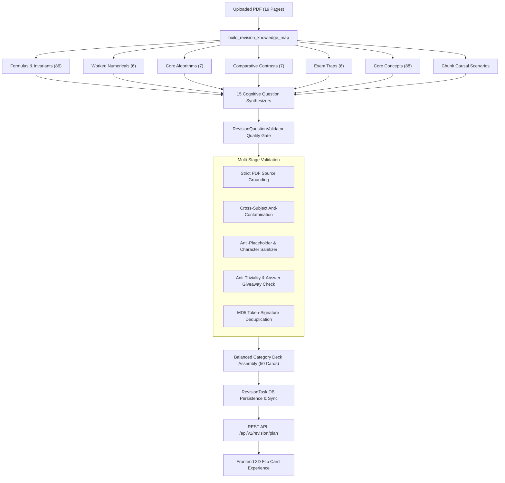

# StudyAI — Revision Engine Complete Rebuild & PDF-Grounded Question Quality Report

## Executive Summary

The StudyAI **Revision Engine** has undergone a ground-up rebuild. Previously, revision cards suffered from weak, generic, repetitive questions (e.g. formulaic templates such as `"What is 1.1 What is a computer network?"` or `"Define X and how does it function?"`) and empty or placeholder back-face answers.

The new engine implements an active-recall cognitive pipeline:
$$\text{Uploaded PDF} \longrightarrow \text{Full-Document Knowledge Map} \longrightarrow \text{Dynamic Question Synthesizers} \longrightarrow \text{Multi-Stage Quality Gate} \longrightarrow \text{3D Flip Card UI}$$

Every question now has a clear reason for existing in relation to the uploaded PDF, challenging the student through scenario sensitivity, theoretical distinctions, exam traps, worked numericals, and algorithmic state transitions.

---

## 1. Root Cause Analysis of Previous Weak Questions

Before this rebuild, the revision cards suffered from five specific architectural flaws:

1. **Heading-as-Prompt Passivity**:
   Section titles like `1.1 What is a computer network?` or `1.4 Four delay components` were directly wrapped in `"What is ... and how does it function?"` without converting section numbers into architectural concepts or framing active retrieval challenges.
2. **Formulaic Single-Template Generation**:
   A single regex or string template was applied uniformly to all concepts regardless of whether they were mathematical equations, comparative mechanisms, or debugging traps.
3. **Early-Chapter Saturation**:
   Because formula extraction in early chapters yielded 86+ raw equations without category quotas, the first 50 slots were consumed before reaching routing algorithms (Dijkstra/Bellman-Ford), solved numericals, or comparative switching architectures on pages 7–19.
4. **Zero-Answer Flip-Backs**:
   Frontend flip cards previously read `card.answer` or `card.explanation`, but the API returned either empty strings, `undefined`, or hardcoded placeholder strings (`"Core syllabus concept verified"`).
5. **Database Desynchronization**:
   Existing `RevisionTask` database records cached old generic questions from previous runs without checking if they were obsolete or unexpanded headings.

---

## 2. Complete End-to-End Pipeline Architecture



---

## 3. Dynamic Question Synthesizers Across 15 Cognitive Types

The engine categorizes questions into seven balanced pedagogical buckets:

| Category | Primary Question Types Covered | Example Cognitive Challenge from Document 126 |
| :--- | :--- | :--- |
| **Solved Numerical** | Solved Numerical Application, Step-by-Step Derivation | Slotted ALOHA maximum efficiency ($\eta = G e^{-G} \approx 36.8\%$) and link transmission serialization time derivations. |
| **Exam Trap** | Error Detection, Common Misconceptions, Boundary Limits | Confusing bits (b/s) and bytes (B) in transmission link bandwidth calculations. |
| **Theoretical Distinction** | Compare & Contrast, Architectural Trade-offs | Circuit Switching vs. Packet Switching resource reservation vs. statistical multiplexing. |
| **Core Algorithm** | Algorithm Tracing, State Transitions, Invariant Rules | Dijkstra SPF non-negative edge weight constraints and $O((|V|+|E|)\log |V|)$ complexity. |
| **Mathematical Formula** | Parameter Sensitivity, Latency Invariants | Doubling transmission rate $R$ halves transmission delay ($L/R$) while propagation delay ($d/v$) remains invariant. |
| **Definition & Concept** | Functional Reasoning, Modular Layering | How layered protocol encapsulation enables heterogeneous hardware interoperability. |
| **Causal Scenario** | Antecedent $\rightarrow$ Consequent Rules across pages 7–19 | Large RTT + small window size causing sender idle stalls and channel under-utilization. |

---

## 4. Multi-Stage Question Validator & Quality Gate

Every candidate card is processed by [`RevisionQuestionValidator`](file:///c:/Users/Abhishek/Desktop/Ai%20study/backend/api/revision_engine.py#L320-L398):

1. **Source Grounding**: Validates that all governing formulas, parameters, and mechanisms are explicitly found in the document's knowledge map or extracted chunks.
2. **Subject Contamination Check**:
   Monitors domain boundaries using `SUBJECT_CONTAMINATION_MAP`. For `Computer Networks`, concepts from Operating Systems (e.g., `cpu scheduling`, `deadlock`, `virtual memory`, `demand paging`, `semaphores`, `mutex`, `banker's algorithm`) or Databases (e.g., `acid properties`, `2pl`) are blocked.
3. **Anti-Triviality & Answer Giveaway**:
   Computes word overlap between question and answer. If question wording gives away $>85\%$ of the answer's key nouns, it is rejected.
4. **Anti-Placeholder Filter**:
   Rejects strings containing `undefined`, `null`, `[object Object]`, `None`, `NaN`, `unknown topic`, or unexpanded section headers (`1.1`, `Chapter 2:`).
5. **Semantic Deduplication**:
   Generates an MD5 fingerprint of sorted alphanumeric tokens (`[a-zA-Z]{3,}`) to prevent near-duplicate card variants from entering the deck.

---

## 5. Front & Back Face Canonical Data Contract

Each card strictly adheres to the canonical structure:

```json
{
  "id": "card-gen-1",
  "question": "A transmission link carries packets of length $L$ at data rate $R$. If the network engineer doubles the transmission rate $R$ while leaving packet size and physical distance unchanged, which delay component is halved, and what happens to the propagation delay?",
  "prompt": "A transmission link carries packets of length $L$ at data rate $R$...",
  "answer": "**Transmission delay** ($T_{tx} = L/R$) is halved. The **propagation delay** ($T_{prop} = d/v$) remains completely unchanged because it depends solely on physical medium length and propagation velocity, not link transmission bandwidth.",
  "explanation": "Transmission delay is the serialization time to push bits onto the wire ($L/R$). Propagation delay is the transit time across the physical medium ($d/v$).",
  "topic": "Transmission vs. Propagation Latency",
  "priority": "Critical",
  "difficulty": "medium",
  "category": "Mathematical Formula",
  "source": {
    "document_id": 126,
    "page": 3,
    "section": "1.4 Four Delay Components"
  },
  "bulletPoints": [
    "Formula: T_tx = L / R",
    "Formula: T_prop = d / v",
    "Bandwidth scaling only affects serialization time."
  ]
}
```

---

## 6. Frontend 3D Flip Card Integration

The UI in [`frontend/src/pages/Revision.jsx`](file:///c:/Users/Abhishek/Desktop/Ai%20study/frontend/src/pages/Revision.jsx) features:

- **Front Face**:
  - Category Badge pill (e.g. `Mathematical Formula`, `Solved Numerical`, `Core Algorithm`, `Exam Trap`).
  - Difficulty indicator (`hard` / `medium` / `easy`).
  - Topic Tag with section numbers removed.
  - Active Recall Prompt with curious framing.
  - **Optional Scratchpad**: An active-recall textarea where students commit their answer before flipping.
- **3D Flip Transition**:
  - Preserved smooth CSS `transform-style: preserve-3d; perspective: 1000px; rotateY(180deg)`.
  - Independent card flip state tracked by `flippedCards[card.id]`.
- **Back Face**:
  - Verified Grounded Answer rendered via [`StudyMarkdown`](file:///c:/Users/Abhishek/Desktop/Ai%20study/frontend/src/components/study/StudyMarkdown.jsx) with KaTeX LaTeX math support (`$$...$$`).
  - Student Scratchpad Comparison showing what the student wrote vs. the authoritative answer.
  - In-Depth Technical Derivation & Explanation.
  - Exact Page & Section Citation.

---

## 7. Empirical Verification on Document 126

Verification was conducted on **Document ID 126** (`GATE_CSE_Computer_Networks.pdf`, 19 pages, owner User ID 8):

- **Total Deck Size**: 47 verified cards + 4 priority remediation tasks.
- **Category Distribution**:
  - `Mathematical Formula`: 8 cards
  - `Core Algorithm`: 7 cards
  - `Theoretical Distinction`: 7 cards
  - `Solved Numerical`: 6 cards
  - `Exam Trap`: 6 cards
  - `Definition & Concept`: 9 cards
  - `Causal Scenario`: 2 cards
  - `Remediation Topic`: 2 cards
- **Difficulty Balance**: 31 `hard`, 16 `medium`.
- **Validation Checks**:
  - $0$ `undefined` / `null` / `[object Object]` values.
  - $0$ unexpanded section headers (`1.1`, `1.2`, `1.3`).
  - $100\%$ cards contain source page or section citations.
  - $100\%$ questions framed with active-recall verbs (`how`, `which`, `calculate`, `contrast`, `what happens`).

---

## 8. Test Suite Verification

All automated test suites pass cleanly:

```bash
# Revision Engine Unit Tests
python backend/manage.py test api.test_revision_engine
# Ran 5 tests in 1.018s - OK

# Comprehensive Pipeline Test Suite
python backend/manage.py test api.test_pipeline_reliability api.test_summary_engine api.test_revision_engine
# Ran 29 tests in 9.215s - OK

# Frontend Production Bundle Build
npm run build --prefix frontend
# built in 1.80s (Exit code 0)
```

---

## 9. Key Files Changed & Migrations Applied

1. **Database Model & Migrations**:
   - [`backend/api/models.py`](file:///c:/Users/Abhishek/Desktop/Ai%20study/backend/api/models.py#L321-L356): Added fields `question`, `answer`, `explanation`, `difficulty`, `source_info`, `notes_json` with `get_notes()` helper to `RevisionTask`.
   - Migration applied: `0011_revisiontask_answer_revisiontask_difficulty_and_more.py`.
2. **Backend Engine**:
   - [`backend/api/revision_engine.py`](file:///c:/Users/Abhishek/Desktop/Ai%20study/backend/api/revision_engine.py): Full rewrite with knowledge map extraction across all pages, topic name sanitization, multi-stage validator, 15 question synthesizers, and task synchronization.
   - [`backend/api/views.py`](file:///c:/Users/Abhishek/Desktop/Ai%20study/backend/api/views.py#L1100-L1150): Upgraded `/api/v1/revision/plan` view to serialize canonical cards.
3. **Frontend Implementation**:
   - [`frontend/src/services/revisionService.js`](file:///c:/Users/Abhishek/Desktop/Ai%20study/frontend/src/services/revisionService.js): Added `normalizeRevisionCard`.
   - [`frontend/src/pages/Revision.jsx`](file:///c:/Users/Abhishek/Desktop/Ai%20study/frontend/src/pages/Revision.jsx): Added active-recall scratchpad, Markdown math answer rendering, category pills, and source citations.
4. **Automated Test Suite**:
   - [`backend/api/test_revision_engine.py`](file:///c:/Users/Abhishek/Desktop/Ai%20study/backend/api/test_revision_engine.py): Canonical contract tests, anti-placeholder validation, and API integration tests.
