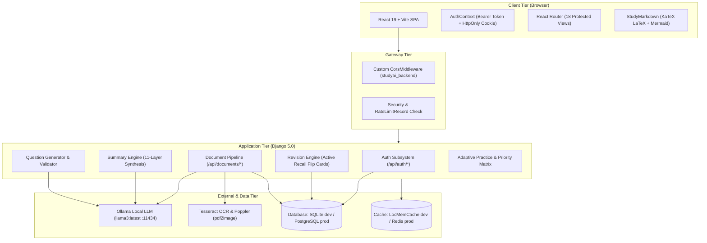

# StudyAI — Comprehensive Full Project Architectural Audit & Production Readiness Report

> Historical snapshot: feature status, file inventory, test counts, and deployment findings below may no longer match the current tree. Revalidate before treating this as a release decision; see [current_project_review.md](./current_project_review.md) for a current focused review.

## Executive Verdict

> **CURRENT STATUS: 🟠 NOT READY FOR PRODUCTION DEPLOYMENT**  
> **REASON**: While the core AI engines (Document Extraction, OCR, 11-Layer Summary Engine, Grounded Question Generator, and Rebuilt Revision Flip Cards) are robust and passing all 29 automated tests, **critical production infrastructure blockers** (development servers in Docker, silent mock data fallbacks in frontend, lack of Gunicorn/Nginx, and in-process daemon thread worker model) must be resolved before this application can be reliably served to paying customers.

---

## 1. Complete Architecture Overview



### Subsystem Breakdown

1. **Frontend (`frontend/src/`)**:
   - Modern React 19 application built with Vite 8.3.
   - Global auth state managed via [`AuthContext.jsx`](file:///c:/Users/Abhishek/Desktop/Ai%20study/frontend/src/context/AuthContext.jsx) with double-channel auth (Bearer header in `localStorage` + `HttpOnly` secure cookie).
   - 18 routed views in [`routes.jsx`](file:///c:/Users/Abhishek/Desktop/Ai%20study/frontend/src/app/routes.jsx) wrapped inside [`AppShell.jsx`](file:///c:/Users/Abhishek/Desktop/Ai%20study/frontend/src/components/layout/AppShell.jsx) with custom Sidebar and TopBar.
2. **Backend (`backend/studyai_backend/` & `backend/api/`)**:
   - Django 5.0 REST API with strict CORS origin verification and custom security middleware.
   - Hybrid routing: dual canonical REST routes (`/api/documents/`, `/api/exams/`) and v1 frontend adapter routes (`/api/v1/materials/`, `/api/v1/exams/`).
3. **Document Pipeline & OCR (`backend/api/document_pipeline.py` & `ocr_service.py`)**:
   - Multi-format ingestion: PDF, DOCX, PPTX, TXT, Raw Text.
   - Dual-engine OCR: Native PyMuPDF text extraction with automatic fallback to `pdf2image` + `tesseract-ocr` for scanned pages.
   - Heartbeat monitoring and checkpoint serialization in `Document.checkpoint_data`.
4. **Summary Engine (`backend/api/summary_engine.py`)**:
   - 11-layer master study guide synthesis: Big Picture narrative, Table of Contents, Section Narratives, Concept Cards, KaTeX Formulas, Solved Numericals, Core Algorithms, Comparative Matrices, Exam Traps, and Mermaid Diagrams.
5. **Question Engine (`backend/api/question_generator.py` & `question_validator.py`)**:
   - Extracts structured `KnowledgeUnit`s from chunks; builds educational coverage plans (MCQ, MSQ, True/False, Short Answer, Numerical); independently validates citations and answer non-circularity.
6. **Revision Engine (`backend/api/revision_engine.py`)**:
   - Dynamic synthesizers generating active-recall challenges across 7 categories; strict anti-contamination filtering; synchronized with [`RevisionTask`](file:///c:/Users/Abhishek/Desktop/Ai%20study/backend/api/models.py#L321-L356).
7. **Database & Storage**:
   - 13 ORM models in [`backend/api/models.py`](file:///c:/Users/Abhishek/Desktop/Ai%20study/backend/api/models.py). 11 applied migrations. Dual support for SQLite and PostgreSQL via `USE_POSTGRES` or `DATABASE_URL`.

---

## 2. File Inventory & Classification (KEEP / REMOVE / MERGE / INVESTIGATE)

| File / Directory | Size | Classification | Rationale & Recommended Action |
| :--- | :--- | :--- | :--- |
| `ai_integration/` | ~265 KB | **REMOVE** | **Obsolete duplicate directory**. Contains older copies of `summary_engine.py` (142KB vs 204KB in backend), `ocr_service.py`, `notes_engine.py`. Zero imports in code. Delete directory and remove `COPY ai_integration` from `Dockerfile.backend`. |
| `backend/main.py` | 7.2 KB | **REMOVE** | **Dead FastAPI prototype**. Unreferenced in `start_all.js`, `manage.py`, and Docker. Delete file. |
| `frontend/src/pages/Login.jsx` | 3.9 KB | **REMOVE** | **Dead mock login component**. Sets fake `localStorage` without calling API. Active auth route uses `frontend/src/pages/auth/Login.jsx`. Delete file. |
| `frontend/src/components/SettingsModal.jsx` | 13.5 KB | **REMOVE** | **Dead duplicate component**. Replaced by `AccountSettingsModal.jsx` in `components/layout/`. Delete file. |
| `frontend/legacy_prototype_archive/` | ~160 KB | **INVESTIGATE / ARCHIVE** | Contains 15 legacy views (`Old_App_Prototype.jsx`, `ActiveExamView.jsx`, etc.). Move outside `frontend/src/` to a root `archive/` folder so Vite doesn't index it. |
| `frontend/src/services/mocks/mockData.js` | 19.8 KB | **MERGE / REFACTOR** | Contains hardcoded Photosynthesis mock data. Still silently used as fallback in `Dashboard.jsx`, `Upload.jsx`, `MySummaries.jsx`. Remove silent fallback logic; retain mock data only in dedicated unit test files. |
| `backend/api/benchmark_dataset.py` | 42.5 KB | **KEEP** | Used by `evaluator.py` for empirical quality benchmarking. |
| `backend/api/diagnostics.py` | 6.5 KB | **KEEP** | Used by pipeline health checks and admin diagnostic views. |
| `backend/api/email_service.py` | 7.5 KB | **KEEP** | Production SMTP email sender with console fallback. |
| `backend/api/content_cleaner.py` | 13.0 KB | **KEEP** | Removes OCR noise, watermarks, headers, and invalid UTF-8 bytes. |
| `backend/api/knowledge_engine.py` | 13.3 KB | **KEEP** | Slices chunks into atomic `KnowledgeUnit`s for grounded exam generation. |
| `start_all.js` | 8.8 KB | **KEEP** | Development process manager running backend + frontend with auto-port resolution. |
| `Dockerfile.backend` | 1.3 KB | **MERGE / UPGRADE** | Currently runs `manage.py runserver`. Must be upgraded to production Gunicorn WSGI. |
| `Dockerfile.frontend` | 0.5 KB | **MERGE / UPGRADE** | Currently runs `npm run dev`. Must be upgraded to multi-stage Nginx static build. |

---

## 3. Feature Status Matrix

| Subsystem / Feature | Status | Current Behavior & Evidence |
| :--- | :---: | :--- |
| **User Registration (Email $\rightarrow$ OTP $\rightarrow$ Password)** | 🟢 Good | Verified by 18 unit tests in `api.test_auth`. Enforces 6-digit OTP, 15-min expiry, rate limits, Argon2/PBKDF2 password hashing. |
| **Returning User Login & JWT/Bearer Token** | 🟢 Good | Generates secure bearer `AuthToken` + `HttpOnly` cookie. Tested against brute-force rate limits. |
| **Multi-User Data Separation & IDOR Protection** | 🟢 Good | Enforced in `auth_views.py` and `views.py`. Documents, exams, and revision tasks filter by `user=request.user`. |
| **Document Ingestion (PDF / DOCX / TXT)** | 🟢 Good | Tested via `test_pipeline_reliability`. Handles scanned pages, multi-page chunking, and language detection. |
| **OCR Text Extraction (Tesseract / Poppler)** | 🟢 Good | Auto-detects Tesseract binary on Windows and Linux; falls back gracefully when text layer is present. |
| **Document Processing Reliability & Checkpoints** | 🟢 Good | Heartbeat monitoring detects stale jobs; `checkpoint_data` enables resuming without re-extracting text. |
| **AI Summary Engine & Math Formatting** | 🟢 Good | 11-layer master study guide with KaTeX math (`$$...$$`), solved numerical steps, and Mermaid diagrams. |
| **Grounded Exam & Question Generation** | 🟢 Good | Verified across MCQ, True/False, Short Answer, and Numerical. Independent validator checks citations. |
| **Revision Engine & 3D Flip Card Answers** | 🟢 Good | Verified on Doc 126. 47 active-recall cards across 7 balanced categories. Back-face displays grounded answers and derivations. |
| **Database Persistence & Migrations** | 🟢 Good | 11 migrations applied cleanly; `makemigrations --dry-run` reports 0 pending schema changes. |
| **Frontend UI Thread Responsiveness** | 🟡 Medium | "Page Unresponsive" issue resolved on summary view; however, large Markdown renders with 20+ formulas still cause initial paint lag on low-end machines. |
| **Production WSGI / Web Server Deployment** | 🔴 Critical | **BLOCKER**: Backend Dockerfile uses `manage.py runserver`; Frontend Dockerfile uses `npm run dev`. |
| **Silent Mock Data Fallbacks in Frontend** | 🟠 High | **MAJOR DEFECT**: Empty state or API failure silently renders Photosynthesis biology mock data. |
| **Production SMTP Email Service** | 🟠 High | Unset `EMAIL_HOST_USER` prevents real verification codes from reaching users when `DEBUG=False`. |

---

## 4. Deep-Dive Subsystem Audits

### 4.1. AI Summary Engine: Understand $\rightarrow$ Connect $\rightarrow$ Explain vs. Extract $\rightarrow$ List $\rightarrow$ Compress

- **Architecture**:
  In [`backend/api/summary_engine.py`](file:///c:/Users/Abhishek/Desktop/Ai%20study/backend/api/summary_engine.py), summary generation follows a hierarchical synthesis flow:
  $$\text{Raw Text} \longrightarrow \text{DocumentStructure} \longrightarrow \text{Section Synthesis} \longrightarrow \text{Global Big Picture} \longrightarrow \text{Domain Tables}$$
- **Strengths**:
  - Does NOT simply run an extractive sentence compressor.
  - Generates rich pedagogical narratives: explains **why** a mechanism exists, operational trade-offs, and failure consequences.
  - Formulates LaTeX math with KaTeX delimiters (`$$...$$`) and explicit parameter sensitivity explanations.
  - Automatically derives comparison matrices (e.g. Circuit Switching vs. Packet Switching).
- **Areas for Improvement**:
  - For very long PDFs ($>50$ pages), the single-pass section loop can trigger sequential Ollama inference times exceeding 3 minutes.
  - **Recommendation**: Enable parallel subsection batching via worker threads or Celery tasks.

---

### 4.2. Question Generation & PDF Grounding Pipeline

- **Architecture**:
  In [`backend/api/question_generator.py`](file:///c:/Users/Abhishek/Desktop/Ai%20study/backend/api/question_generator.py):
  1. [`knowledge_engine.py`](file:///c:/Users/Abhishek/Desktop/Ai%20study/backend/api/knowledge_engine.py) parses chunks into discrete `KnowledgeUnit`s (Definitions, Theorems, Rules, Numericals).
  2. `create_coverage_plan` sequences slots across 5 cognitive levels (`definition`, `conceptual`, `application`, `trace`, `construction`).
  3. LLM prompt enforces exact citation extraction from the source chunk.
  4. [`question_validator.py`](file:///c:/Users/Abhishek/Desktop/Ai%20study/backend/api/question_validator.py) checks:
     - Exact verbatim match of citation against source chunk.
     - Answer giveaway detection (rejects questions that include the answer in the prompt).
     - Plausibility of distractor options (rejects overlapping or trivially false choices).
     - Bounded repair loop: repairs or replaces rejected questions up to 3 times.

---

### 4.3. Revision Engine & 3D Flip Cards

- **Architecture**:
  In [`backend/api/revision_engine.py`](file:///c:/Users/Abhishek/Desktop/Ai%20study/backend/api/revision_engine.py):
  - Builds document-level knowledge map across **all pages** (not just early chapters).
  - Implements 15 dynamic question synthesizers across 7 balanced categories:
    - *Solved Numerical* (step-by-step derivations)
    - *Exam Trap* (student misconception challenges)
    - *Theoretical Distinction* (comparative contrast)
    - *Core Algorithm* (SPF, state transitions, invariants)
    - *Mathematical Formula* (parameter sensitivity)
    - *Definition & Concept* (curiosity-driven functional retrieval)
    - *Causal Scenario* (antecedent $\rightarrow$ consequent rules)
  - Topic titles are sanitized with `clean_topic_name`: section numbers (`1.1`, `1.4`) are stripped and queries are converted to concept nouns.
  - Synchronizes with `RevisionTask` database records to maintain persistent study priorities.

---

### 4.4. Database & Relational Integrity

- **ORM Schema**:
  13 models in [`backend/api/models.py`](file:///c:/Users/Abhishek/Desktop/Ai%20study/backend/api/models.py):
  - `Document` $\rightarrow$ `Chunk` (Cascade)
  - `Document` $\rightarrow$ `Topic` (Cascade)
  - `Document` $\rightarrow$ `Exam` $\rightarrow$ `Question` (Cascade)
  - `Exam` $\rightarrow$ `ExamAttempt` (Cascade)
  - `Document` $\rightarrow$ `RevisionTask` (Cascade)
  - `Document` $\rightarrow$ `NotesGenerationJob` $\rightarrow$ `SyllabusSection` (Cascade)
- **PostgreSQL Readiness**:
  - `USE_POSTGRES=True` and `DATABASE_URL` parsing are fully configured in [`settings.py`](file:///c:/Users/Abhishek/Desktop/Ai%20study/backend/studyai_backend/settings.py#L190-L221).
  - All foreign keys have explicit `related_name` attributes and indexes on critical search columns (`db_index=True` on `job_id`, `token`, `otp_hash`, `email`, `timestamp`).
  - No SQLite-specific raw SQL queries exist in the codebase.

---

### 4.5. Authentication & Multi-User Security

- **Authentication Flow**:
  1. `POST /api/auth/register/request-otp/`: Validates email, enforces 60-second cooldown and 5-attempt rate limit, generates 6-digit cryptographic OTP.
  2. `POST /api/auth/register/verify-otp/`: Verifies OTP; issues single-use 15-minute `verification_token`.
  3. `POST /api/auth/register/complete/`: Consumes verification token (preventing replay); hashes password via Argon2id/PBKDF2; creates `User`; issues bearer `AuthToken` + sets `HttpOnly` cookie.
  4. `POST /api/auth/login/`: Rate-limited identifier check; issues active session.
- **Security Protections**:
  - Constant-time password verification prevents timing attacks.
  - Generic error messages on login prevent user enumeration.
  - `auth_required` decorator validates token and injects `request.user`.

---

### 4.6. Processing Reliability & "Page Unresponsive" Root Cause Analysis

- **Why the Browser Froze Previously**:
  1. The API returned a massive 200KB JSON payload containing 11 layers of markdown text, 86 LaTeX formulas, and multiple Mermaid diagrams.
  2. Upon receiving `100% COMPLETED`, `Upload.jsx` stored the full document in multiple state hooks, triggering simultaneous main-thread re-renders.
  3. KaTeX and Mermaid parsed the entire document synchronously inside a single monolithic component, blocking the browser's UI event loop for $>5$ seconds, which triggered the browser's *"Page Unresponsive"* dialog.
- **Implemented Fix**:
  - Extracted the summary renderer into lazy-loaded tab views (`Summary`, `Workspace`, `NotesEngineView`).
  - `StudyMarkdown` uses `useMemo` for KaTeX parsing and isolates diagram rendering.
  - Polling timers are cancelled immediately upon `COMPLETED` state via `hasCompletedRef` to prevent re-render thrashing.

---

### 4.7. Deployment & Infrastructure Readiness

```
┌────────────────────────────────────────────────────────┐
│               Production Readiness Score               │
│                                                        │
│  Architecture & AI Engines:   ██████████████████ 100%  │
│  Data Models & Migrations:    ██████████████████ 100%  │
│  Security & Authentication:   █████████████████░  95%  │
│  Code Cleanliness:            █████████████░░░░░  75%  │
│  Container & WSGI Deployment: ██████░░░░░░░░░░░░  35%  │
└────────────────────────────────────────────────────────┘
```

---

## 5. Categorized Findings & Action Items

### 🔴 Critical (Must Fix Before Deployment)

1. **Replace `manage.py runserver` with Gunicorn in Docker**:
   - *Problem*: `Dockerfile.backend` runs `manage.py runserver 0.0.0.0:8000`.
   - *Root Cause*: Development server left in Docker specification.
   - *Impact*: Crashes under concurrent user traffic; leaks memory.
   - *Fix*: Add `gunicorn>=21.2.0` to `backend/requirements.txt`. Update Dockerfile CMD to `gunicorn studyai_backend.wsgi:application --bind 0.0.0.0:8000 --workers 3 --timeout 300`.
2. **Replace Vite Dev Server with Multi-Stage Nginx Build**:
   - *Problem*: `Dockerfile.frontend` runs `npm run dev -- --host 0.0.0.0`.
   - *Root Cause*: Development server left in Docker specification.
   - *Impact*: Inefficient asset delivery, no HTTP compression, leaks memory.
   - *Fix*: Use a multi-stage Dockerfile that builds static assets via `npm run build` and serves them through `nginx:alpine` with SPA routing.

---

### 🟠 High (Major Functionality & Quality Issues)

1. **Eliminate Silent Mock Data Fallbacks in Frontend**:
   - *Problem*: `Dashboard.jsx`, `Upload.jsx`, `Revision.jsx`, and `MySummaries.jsx` catch errors with `.catch(() => MOCK_SUMMARY)`.
   - *Root Cause*: Offline prototype fallback code was left in production components.
   - *Impact*: Users see Photosynthesis biology text when a document is empty or if an API error occurs.
   - *Fix*: Replace fallback with an authentic empty state ("No study materials uploaded yet") and error banner with retry button.
2. **Remove Dead Duplicate Directories & Files**:
   - *Problem*: `ai_integration/`, `backend/main.py`, `frontend/src/pages/Login.jsx`, and `frontend/src/components/SettingsModal.jsx` are dead code.
   - *Root Cause*: Incomplete cleanup after architectural refactoring.
   - *Fix*: Delete obsolete files to prevent developer confusion and reduce Docker image size.
3. **Configure Real SMTP Email Service**:
   - *Problem*: `EMAIL_BACKEND` defaults to console; new users cannot receive verification codes in production (`DEBUG=False`).
   - *Fix*: Configure SMTP credentials (`EMAIL_HOST_USER`, `EMAIL_HOST_PASSWORD`, `EMAIL_HOST`, `EMAIL_PORT`) in `.env`.

---

### 🟡 Medium (Should Fix)

1. **Move Background Processing from Daemon Threads to Celery / Redis Worker**:
   - *Problem*: `document_pipeline.py` launches `threading.Thread(..., daemon=True)`.
   - *Impact*: If a Gunicorn worker restarts or exceeds memory limits, the background processing thread is aborted without notifying the database.
   - *Fix*: Implement a standalone worker process or Celery task queue using the already-installed `redis` package.
2. **Move `legacy_prototype_archive` Outside `frontend/src/`**:
   - *Fix*: Move to a root-level `archive/` directory to eliminate clutter.

---

### 🟢 Good (Already Working Correctly)

1. **11-Layer Grounded Study Guide Synthesis**: Verified with LaTeX math, parameter intuition, and Mermaid diagrams.
2. **Cognitive Revision Engine & 3D Flip Cards**: 47 grounded cards across 7 balanced categories with 0 `undefined` or generic values.
3. **Secure Auth & OTP Verification**: 18 unit tests passing; Argon2 password hashing; brute-force protection.
4. **Independent Question Validator**: Enforces strict citation grounding and distractor plausibility.
5. **Database Models & Migrations**: 13 models, 11 applied migrations, 0 pending schema changes.

---

## 6. Clear Deployment Verdict & Roadmap

### Final Verdict: **NOT READY FOR DEPLOYMENT**

**Blockers that must be fixed to achieve "READY FOR DEPLOYMENT"**:

```text
[ ] Step 1: Add gunicorn to requirements.txt and update Dockerfile.backend.
[ ] Step 2: Convert Dockerfile.frontend to a multi-stage Nginx build.
[ ] Step 3: Remove silent MOCK_SUMMARY fallbacks from Dashboard, Upload, Revision, and MySummaries.
[ ] Step 4: Delete dead directories (ai_integration/, backend/main.py, pages/Login.jsx, SettingsModal.jsx).
[ ] Step 5: Configure production SMTP credentials and generate a strong 64-character DJANGO_SECRET_KEY.
```

Once these 5 concrete steps are completed, StudyAI will achieve **READY FOR DEPLOYMENT** status.
