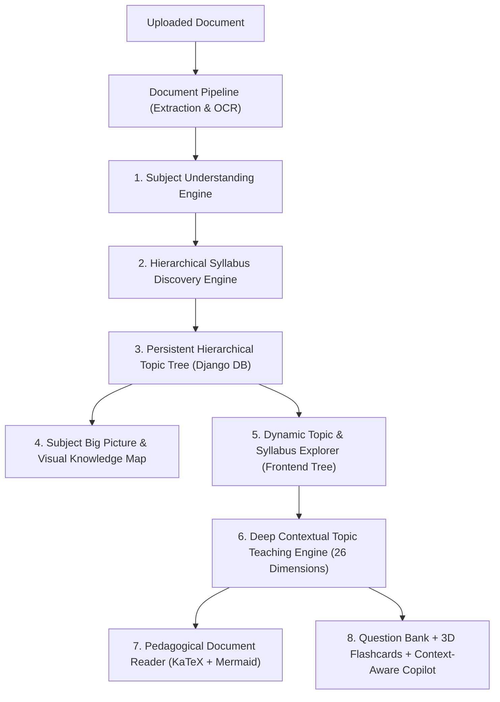

# StudyAI — Complete Subject Understanding, Syllabus Discovery & Deep Contextual Teaching Engine
## Phase 1: Comprehensive System Audit & Architectural Assessment Report

> Historical snapshot: several gaps described below (including the absence of a syllabus hierarchy and topic-teaching engine) no longer reflect the current code. Revalidate other claims and test counts against the current tree; see [current_project_review.md](./current_project_review.md) for the latest focused review.

**Date:** November 2026  
**Auditor:** Senior AI/ML Architect, Document Intelligence Engineer, & Full-Stack Systems Team  
**Scope:** Complete repository audit across backend services, AI engines, data models, frontend components, and pipeline integration.

---

## 1. Executive Summary

StudyAI currently functions as a reliable document ingestion and multi-mode notes generator, complete with OCR fallbacks, grounded question generation, and 3D flashcard revision. However, **it still behaves largely as an extractive document summarizer rather than an intelligent, authoritative subject teacher**.

When a student uploads a 43-page textbook on Computer Networks (e.g., Document 134), the current system:
1. Discovers only **8 flat topics**, some of which are noisy sentence fragments (e.g., *"Chapter 4: If the checksum is not zero, the entire packet is dropped"*) or cover-page author metadata (e.g., *"Srinivas Rao"*).
2. Divides the 43-page document into only **5 rough sections**, leaving pages 27–32 and 35–43 completely orphaned.
3. Produces a single monolithic summary rather than discovering the true hierarchical curriculum:
   $$\text{Subject} \longrightarrow \text{Knowledge Area} \longrightarrow \text{Chapter} \longrightarrow \text{Section} \longrightarrow \text{Topic} \longrightarrow \text{Subtopic} \longrightarrow \text{Concept}$$
4. Lacks an interactive **Topic Teaching Engine** that explains any selected topic in depth with step-by-step working principles, mathematical derivations, architecture diagrams, verified calculations, and common misconceptions.
5. Lacks an explicit **Document Coverage Matrix** proving whether every theorem, algorithm, formula, and section has been extracted, understood, taught, and verified.

This report establishes the baseline audit of all existing components, identifies root causes, and designs the upgrade to transform StudyAI into a comprehensive contextual teaching platform.

---

## 2. End-to-End Execution Trace (Current State)

```text
Student File (PDF/DOCX/TXT)
  │
  ▼
[DocumentPipeline (document_pipeline.py)]
  ├── 1. Signature & Magic Bytes Validation (validate_file_content_signature)
  ├── 2. Extraction & OCR (extract_study_material / ocr_service.py)
  ├── 3. Cleaning & Page Chunking (clean_text / chunk_document_by_pages)
  │       └── Stores 800-1200 word Chunks with page_start & page_end
  ├── 4. Shallow AI Analysis (analyze_document_with_ai / ollama_service.py)
  │       └── Emits flat Topic records (max 8-12 topics)
  ├── 5. Monolithic Synthesis (synthesize_study_guide / summary_engine.py)
  │       └── Builds single JSON object stored in Document.summary_json
  └── 6. Status = COMPLETED (or PARTIAL / FAILED)
```

### Downstream Consumer Consumption:
- **`Summary.jsx`**: Reads `doc.summary_json` and displays the monolithic markdown study guide in 5 modes (Standard, Detailed, Deep Study, Quick Revision, Exam Prep).
- **`NotesEngineView.jsx`**: Spawns an asynchronous `NotesGenerationJob` that slices sections and calls LLM or fallback deterministic generator to write notes per section.
- **`TopicIntelligence.jsx`**: Reads flat `doc.topics.all()` and renders a 2x2 priority matrix.
- **`Workspace.jsx`**: Displays active document telemetry, a flat topic list, and copilot drawer.
- **`Revision.jsx`**: Constructs 3D flashcards from `doc.summary_json` and `RevisionTask` models.
- **`ExamConfig.jsx` & `Exam.jsx`**: Generates grounded questions based on chunks and knowledge units.

---

## 3. Deep-Dive Component Audit

### 3.1 Document Service (`backend/api/document_service.py`)
- **Status**: Strong & Stable.
- **Strengths**: Efficient PyMuPDF (`fitz`) page extraction, text block geometry parsing, magic-byte signature validation for PDF, DOCX, TXT.
- **Defects & Limitations**:
  - Treats heading detection via raw font-size heuristics. In multi-column textbooks or documents with non-standard formatting, body text emphasized in bold is frequently misclassified as a top-level chapter heading.
  - Does not construct a persistent document hierarchy (no tree structure preserved from table of contents).

### 3.2 OCR Service (`backend/api/ocr_service.py`)
- **Status**: Reliable with Structured Error Taxonomy.
- **Strengths**: Bounded timeout, Tesseract auto-discovery across Windows/Linux/macOS, resolution scaling with `pdf2image`, fallback handling.
- **Defects & Limitations**:
  - Scanned pages with mathematical equations often suffer from Unicode symbol degradation (e.g., Greek letters $\delta, \epsilon, \lambda$ degraded into random punctuation).
  - Clean academic text reconstruction lacks layout-aware column un-wrapping for complex two-column academic papers.

### 3.3 Content Cleaner (`backend/api/content_cleaner.py`)
- **Status**: Effective Heuristics.
- **Strengths**: Removes repetitive running headers, footers, page numbering artifacts, watermark noise, and character-by-character vertical text stacking.
- **Defects & Limitations**:
  - `is_malformed_concept_name` rejects short strings, but fails to filter long run-on sentences that start with chapter numbers (e.g. *"Chapter 4: If the checksum is not zero..."*).

### 3.4 Document Pipeline (`backend/api/document_pipeline.py`)
- **Status**: Robust State Machine.
- **Strengths**: Atomic transactions, heartbeat tracking, stale job recovery, cancellable executions, and non-blocking background threading.
- **Defects & Limitations**:
  - The pipeline transitions directly from `CHUNKING` to `AI_ANALYSIS` and `SYNTHESIZING`. It completely bypasses deep subject-level modeling.
  - It does not produce an internal Subject Understanding Knowledge Representation.

### 3.5 Knowledge Engine (`backend/api/knowledge_engine.py`)
- **Status**: Solid Concept & Rule Extraction.
- **Strengths**: Defines `KnowledgeUnit` dataclass with cognitive tags, definitions, formulas, and page citations.
- **Defects & Limitations**:
  - Knowledge units are extracted as an unlinked collection of definitions.
  - There is no relational graph connecting Knowledge Units to their parent chapter, prerequisites, or pedagogical progression.

### 3.6 Summary Engine (`backend/api/summary_engine.py`)
- **Status**: Large Monolithic Synthesis Engine (204 KB).
- **Strengths**: Multi-mode guides, KaTeX formula formatting, Mermaid diagram generation, exam trap warnings, and anti-contamination subject filters.
- **Defects & Limitations**:
  - **Monolithic Output**: Produces one massive markdown document per mode. For a 50+ page textbook, the LLM cannot cover every topic in depth without hitting context-window limits and truncating downstream sections.
  - **Noisy Section Splitting**: `detect_document_structure` uses regex heading matchers that pick up arbitrary bold sentences as chapters.
  - **No Deep Interactive Teaching**: Does not support dynamic on-demand deep-dive teaching when a student clicks on a specific subtopic or concept.

### 3.7 Notes Engine (`backend/api/notes_engine.py`)
- **Status**: Functional Section-by-Section Processor.
- **Strengths**: Background `NotesGenerationJob` with section-level retry and DOCX/PDF export.
- **Defects & Limitations**:
  - Completely decoupled from `summary_engine.py` and `Topic` models.
  - Uses its own separate `SyllabusSection` models that do not synchronize with `Topic` or `RevisionTask`.
  - Explanations are often shallow (1–2 paragraphs per section) rather than deep, multi-dimensional master teaching.

### 3.8 Ollama Service (`backend/api/ollama_service.py`)
- **Status**: Capable Local LLM Interface.
- **Strengths**: JSON mode enforcement, configurable temperature, retry logic, timeout safeguards.
- **Defects & Limitations**:
  - Context window is constrained to 4096–8192 tokens. Passing 20 chunks at once causes silent truncation of the tail end of the context.
  - Prompts need hierarchical chunk-by-chunk budgeting.

### 3.9 Models (`backend/api/models.py`)
- **Status**: Well-indexed Django ORM.
- **Strengths**: Strong multi-tenant user isolation, tracking fields, foreign keys.
- **Defects & Limitations**:
  - `Topic` model is completely flat. It lacks:
    - `parent` foreign key (self-referential)
    - `node_type` (`knowledge_area`, `chapter`, `section`, `topic`, `subtopic`, `concept`)
    - `hierarchy_path` (e.g. `1.2.4`)
    - `coverage_status` (`DISCOVERED`, `EXTRACTED`, `TEACHING_READY`, `VERIFIED`)
    - `teaching_content` (rich pedagogical markdown)
    - `diagram_mermaid` (verified dynamic diagram)
    - `prerequisites_json`, `formulas_json`, `examples_json`, `misconceptions_json`
  - `Document` model lacks a persistent `subject_understanding_json` representation.

### 3.10 Frontend Components (`Summary.jsx`, `Workspace.jsx`, `TopicIntelligence.jsx`, `Revision.jsx`)
- **Status**: Visually polished but disjointed.
- **Defects & Limitations**:
  - `Summary.jsx` displays a static reading view of whatever was generated during upload. If a topic was briefly covered, the student has no way to say "Teach this topic in depth."
  - `TopicIntelligence.jsx` shows flat topic badges on a 2x2 grid, but clicking a topic opens a generic practice modal instead of teaching the topic.
  - `Workspace.jsx` shows document telemetry and flat topic cards, but no interactive hierarchical syllabus tree.

---

## 4. Audit Findings Across the 9 Core Dimensions

### 1. Existing Functionality
- Robust async pipeline, PDF text & OCR extraction, multi-mode summary, grounded MCQs, 3D flashcards with LaTeX math, email OTP auth, and multi-tenant security.

### 2. Duplicate or Conflicting Implementations
- `notes_engine.py` maintains `SyllabusSection` models, while `models.py` maintains `Topic` models, and `summary_engine.py` maintains ephemeral section dictionaries in `summary_json`.
- **Resolution**: Unify around an authoritative, hierarchical `Topic` tree in `models.py` that powers Subject Overview, Topic Exploration, Deep Teaching, Notes Export, Exam Questions, and Revision.

### 3. Missing Functionality
- No internal Subject Understanding representation (purpose, real-world applications, prerequisites, knowledge areas, logical learning order).
- No dynamic hierarchical syllabus explorer (Chapter → Section → Topic → Subtopic → Concept).
- No Deep Contextual Topic Teaching Engine (providing step-by-step working, architecture diagrams, mathematical derivations, variable units, verified calculations, and common misconceptions).
- No Document Coverage Matrix proving what percentage of the source has been analyzed and taught.

### 4. Incorrect Data Contracts
- `doc.topics.all()` produces raw strings and noisy headings without parent-child context or page ranges.
- Flat topic arrays lose the chapter/module hierarchy present in the textbook.

### 5. Broken or Incomplete Integrations
- Large documents (40+ pages) only have 5 sections generated in `summary_json`, leaving over 40% of document pages orphaned from the summary.
- The Copilot answers questions from chunks, but does not know which topic the student is currently studying.

### 6. Model & Context-Window Limitations
- Trying to summarize an entire document in one or two LLM requests causes token truncation and shallow bullet-point summaries.
- **Resolution**: Hierarchical processing: Page extraction → Chunk understanding → Syllabus discovery → On-demand deep-dive topic teaching.

### 7. OCR & Extraction Artifacts
- Long bold headings and author cover-page names are mistakenly extracted as syllabus topics.
- **Resolution**: Strict anti-artifact validator for topic names (filtering author names, page labels, run-on sentences, and chapter fragments).

### 8. Performance Bottlenecks
- Synchronous generation of 5 study modes simultaneously during upload causes long wait times.
- **Resolution**: Fast initial ingestion (Subject Understanding + Complete Syllabus Tree + Overview) in under 20 seconds; generate deep topic teaching on-demand or in progressive background streams.

### 9. Missing Tests
- No tests verifying hierarchical syllabus tree reconstruction.
- No tests verifying deep topic teaching dimension coverage (definitions, derivations, numerical examples, diagrams).

---

## 5. Architectural Blueprint for the Upgrade



### Next Immediate Action:
Proceed with **Phase 2 & Phase 14**:
1. Enhance database schema in `backend/api/models.py` to support hierarchical topics (`parent`, `node_type`, `hierarchy_path`, `coverage_status`, `teaching_content`, `metadata_json`, `diagram_mermaid`) and document subject understanding (`subject_understanding_json`).
2. Run database migrations.
3. Build the **Subject Understanding & Hierarchical Syllabus Discovery Engine**.

